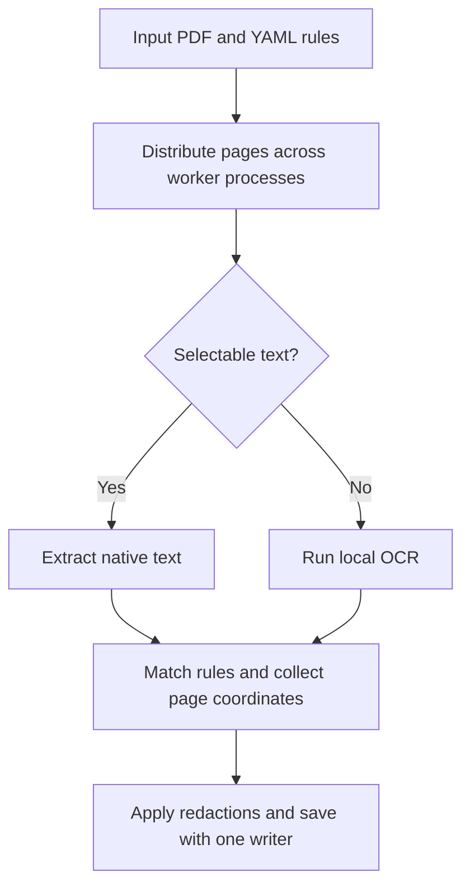

<p align="center">
  
</p>

# HyperScrub

HyperScrub is a local command-line project for redacting sensitive information from large PDFs. It analyzes pages across multiple CPU cores, then applies the detected redactions in a single write pass.

**Status:** Prototype. The portable release, bundled OCR, and commands below describe the planned first release.

## What it does

- Looks for sensitive patterns such as Social Security numbers and for keywords defined in a YAML file.
- Uses native text extraction on searchable pages and local OCR on pages without selectable text. The release is planned to use PyMuPDF’s integrated OCR with bundled English language data.
- Uses PyMuPDF to apply redactions to PDF page content and save a separate output file.
- Runs document processing locally.

## How it works



Workers analyze pages independently and return the coordinates of their matches. One process applies those redactions to the shared output document. This keeps the PDF write coordinated while allowing extraction, OCR, and matching to run concurrently.

## Quick start

The planned release is a portable archive for each supported platform. Download it from the repository’s **Releases** tab, extract it, and run the executable. The archive is designed to include Python, the required libraries, and English OCR data so users can run it without installing dependencies on the host.

**macOS and Linux**

```bash
./hyperscrub --input raw_document.pdf --output redacted_document.pdf --config config.yaml
```

**Windows PowerShell**

```powershell
.\hyperscrub.exe --input raw_document.pdf --output redacted_document.pdf --config config.yaml
```

Example `config.yaml` with a regex pattern and two keywords.

```yaml
patterns:
  ssn: '\b\d{3}-\d{2}-\d{4}\b'

keywords:
  - 'Splunk'
  - 'Okta'
```

## Performance plan

Compare one worker with multiple workers on searchable, scanned, and mixed PDFs. Record the machine, worker count, and page count for each run. Report end-to-end runtime, pages per second, and speedup relative to one worker. Time page analysis and the final redaction-and-save stage separately to show where additional cores help and where the serial stage limits speedup.

## Redaction validation and limits

- Use test PDFs with known sensitive values. Re-extract text from the output and render scanned pages to inspect the targeted image regions.
- Include a page with a selectable header and an embedded scan. The planned page-level OCR fallback can miss sensitive text in the scan because it sees the header's text layer.
- Track metadata, attachments, and form data separately from page-content redaction. Their sanitization still needs implementation and verification.

## Roadmap

- [ ] Package portable CLI archives and test them on clean hosts.
- [ ] Bundle and verify English language data for integrated OCR.
- [ ] Validate regex and keyword matching on native text and OCR output.
- [ ] Handle pages that contain both selectable text and scanned content.
- [ ] Publish multicore benchmark results.
- [ ] Add automated tests and document vulnerability reporting.
